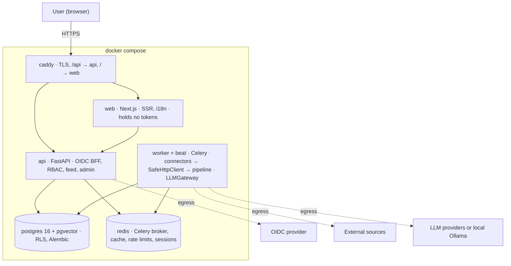

# Pharos architecture

Status: v0 (milestone M1). Describes the intended system; sections marked *planned* are not implemented yet.
Decisions behind it live in [`docs/adr/`](adr/). Where this file and an accepted ADR disagree, the ADR wins.

## 1. Shape of the system

Pharos is a **modular monolith**: one FastAPI backend package (`pharos`), run as two processes (`api` and `worker`), plus PostgreSQL 16 with pgvector, Redis, a Next.js frontend and Caddy as the edge proxy. There are no microservices (ADR-0001).



Dashed arrows are the only traffic that leaves the compose networks (default-deny egress).

- **User requests** never call an LLM. If an insight is not ready, the card shows "being prepared" and a job is queued.
- **Collection** runs on a schedule: beat → worker → connector → pipeline → PostgreSQL.
- **api and worker share the same Python package** and differ only in entry point: `uvicorn --factory pharos.main:create_app` for the API, `celery --app pharos.workers.entrypoint worker` and `... beat` for background work (`make worker`, `make beat` locally).
- **Heartbeat:** beat schedules `pharos.heartbeat` every 60 seconds and a worker writes the current time to Redis (`pharos:worker:heartbeat`); a worker also writes one when it starts. `/readyz` treats the worker as alive while that timestamp is at most 210 seconds old. A fresh timestamp proves beat, broker and worker all work. Tasks are JSON-only, acknowledged late and must be idempotent, because a task is redelivered if its worker dies.
- **Local LLM**: Ollama runs inside compose (profile `local-llm`), and cloud LLM egress is closed when it is selected.

## 2. Backend layout

```text
backend/src/pharos/
├── core/        config, db session, RLS helper, security, logging
├── auth/        OIDC (any provider, Entra preset), sessions, local accounts
├── orgs/ users/ onboarding/
├── sources/     source management, connector registry
├── ingestion/   fetch and normalization tasks
├── content/     items, dedup, embeddings
├── enrichment/  enrichment and insight tasks
├── llm/         LLMGateway, prompts, budget
├── feed/        ranking, cache, cursor pagination
├── admin/ audit/
└── workers/     Celery app, beat schedule
```

Each module has `router.py → service.py → repository.py`, plus `schemas.py` and `models.py`.

- A router holds no SQL and no business logic.
- A service never imports FastAPI.
- A module never touches another module's repository.

These rules are enforced in CI with `import-linter` (*planned*, M1-05).

`connectors/` is a separate Python package (`pharos-connectors`) discovered through entry points; the `SourceConnector` protocol lives in a small SDK package (ADR-0006, *planned* for M3).

## 3. Content pipeline

Six idempotent Celery tasks. The LLM is called in three of them and has no tools: delimited text in, schema-validated JSON out.

1. **Collect** — `connector.fetch(since)`; all HTTP goes through `SafeHttpClient` → `raw_items`.
2. **Normalize** — canonical URL (tracking parameters removed), `url_hash` → `items`.
3. **Cheap filter** (LLM #1) — rules and embedding similarity first; only uncertain items reach a small model.
4. **Cluster** — embedding similarity above a threshold assigns a shared `cluster_id`. Items are grouped, never merged.
5. **Enrich** (LLM #2, strong model) — summary, category, profession relevance, quality score.
6. **Insight** (LLM #3, strong model, lazy) — for `(item, profession, language, prompt_version)`: summary, how to apply, "Try this" prompt, data-safety note.

**How step 1 is scheduled (built in M3-07).** A beat entry runs `pharos.ingest.dispatch` every minute. In one transaction it takes a *lease* (a token and an end time, five minutes) on the sources that are enabled and due, oldest first, at most 20 per run and 40 in flight, using `FOR UPDATE SKIP LOCKED` so two dispatchers never get the same source. Only after that commit does it enqueue one `pharos.ingest.fetch` task per source carrying two identifiers, the source and the lease token; the address and the configuration are read from the database inside the task. The task (1) checks the lease and reads the source, (2) asks a per-host gate in Redis for permission (one request per host every five seconds, otherwise it gives the source back for a few seconds), starts a run and fetches **with no transaction open**, and (3) writes the result in a short transaction only if the lease is still its own. A task delivered twice, or a worker that died, is harmless: the second task finds the lease gone, and an expired lease makes the source due again. After a failure the wait doubles up to a day and obeys `Retry-After`; ten failures in a row mean one try a day until a fetch succeeds; only a person disables a source. A cleanup task (every six hours) deletes fetch runs after 30 days, raw items after 14 and ordinary items after 180, keeps held and hidden items, and marks runs stuck for over an hour as abandoned.

Cost control: insights are generated only for profession/language pairs that have active users and only for items that reach a feed. The AI level is not part of the cache key. A budget check runs in `LLMGateway`: at 80% the admin is warned, at 100% new generation stops while cached insights keep being served.

### Ingestion as built in M3

Steps 1 and 2 of the pipeline above exist in this form (M3, ADR-0006, ADR-0012, ADR-0013). Steps 3 to 6 do not exist yet, and nothing here calls an LLM.

- **Sources.** Rows in `sources`: RSS or Atom feeds, GitHub releases and Hacker News searches, each configuration validated for its type by `pharos.ingest.sourceconfig`. An organization source has no owner; a personal feed has one. Every source has an `enabled` switch. The starter catalogue is imported switched off.
- **Scheduling.** Beat (on the `data` network only) runs `pharos.ingest.dispatch` every minute. It leases due sources and enqueues `pharos.ingest.fetch` with identifiers only (see the scheduling paragraph above).
- **Fetch.** The worker runs the connector. All outbound HTTP goes through `SafeHttpClient` (`pharos.net`): addresses checked at connect time, redirects checked by hand, size and time limits, and the GitHub token sent only to `api.github.com`. Feed bytes go to the parser, which refuses document type declarations and entities before parsing.
- **Pipeline.** Runs in the same transaction as the raw entries: canonical link, exact duplicate check on organization, owner and URL hash, three hold rules that only set flags, and links between items and their sources. Personal items are never merged into organization items.
- **Items.** `pharos.items`: members see current articles; administrators and editors hold, approve, hide and restore them. The `/items` page shows feed text as text only.
- **Personal feeds.** `pharos.feeds` under `/api/me/feeds`: five per person, at least 60 minutes between fetches, visible to the owner only. The address is checked when it is added and again when it is switched on, and `SafeHttpClient` checks it at every fetch. The worker skips the feeds of people who are not active.
- **Trial fetch.** The API queues `pharos.ingest.test_fetch` with identifiers only. The worker fetches the source, writes nothing to the database, and stores a small result under its own Redis prefix (`pharos:worker:testfetch:<test id>`, two minutes). The API reads that result as untrusted data and returns it to the administrator. The API's markers and cooldowns live under its own prefix (ADR-0013).
- **Boundaries.** The worker connects as the `pharos_worker` database role (column grants only) and as a Redis user limited to the Celery queue and `pharos:worker:*` (ADR-0012). Sessions and sign-in state are out of its reach.

## 4. Tenancy

One installation serves one organization, but the code is tenant-aware (ADR-0005).

| Plane | Contents | Rule |
| --- | --- | --- |
| Content (public) | global sources, items, embeddings, insights | `scope='public'`, `owner_org_id` is null |
| Organization-owned content | items from an organization's own sources | `scope='org'`, `owner_org_id` NOT NULL |
| Tenant | users, profiles, interactions, LLM config and usage, audit | `org_id` NOT NULL, RLS |

`org_id` comes only from the authenticated session. Each transaction sets `app.org_id` with `set_config(..., true)`; PostgreSQL row-level security is the second line of defence. The application role does not own the tables and cannot bypass RLS; migrations run with a separate role. See [DATA_MODEL.md](DATA_MODEL.md).

## 5. Authentication

The backend is the BFF (ADR-0003): OIDC Authorization Code with PKCE, `state` and `nonce`, issuer and audience checks, server-side sessions in Redis, and an httpOnly, Secure, SameSite=Lax cookie. Tokens never reach the browser. Entra ID is the first preset; Keycloak is used in dev and E2E tests; local accounts are the fallback. LDAP and SAML are phase 2.

## 6. Frontend

Next.js App Router, TypeScript, Tailwind, shadcn/ui, `next-intl` (ADR-0008). The frontend is presentation only: authentication, authorization and business rules live in the backend, and the browser calls `/api` on the same origin. Locales: `en` (source and fallback), `az`, `tr`, `ru`.

- **Language routing:** every URL starts with the language (`/en`, `/az`, `/tr`, `/ru`). `src/proxy.ts` redirects a path without one: a supported browser language wins, otherwise the installation default applies. The default is `PHAROS_DEFAULT_LOCALE`, read at runtime, so one image serves installations with different defaults.
- **Missing translations:** `scripts/check-i18n.mjs` fails `pnpm build` and `pnpm lint` when a locale lacks a key, has an empty value, has an extra key or uses different placeholders than `en`. At runtime, a gap would still fall back to the English text instead of showing a raw key. `useTranslations` keys are type-checked against `messages/en.json`.
- **Session in the browser (M2):** the session is an HttpOnly cookie the browser cannot read. `SessionProvider` asks `GET /api/me` once and keeps the user and the CSRF token in memory only (never in storage, a cookie or a URL); every state-changing call sends the token as `X-CSRF-Token`. A 401 on any call except sign-in turns the state into "anonymous", and `AppGate` sends the person to `/<locale>/login?next=<page>`; a failed check (backend down) is shown as an error, never as "signed out". `next` is only ever a path on this site (`safeNext`, the backend applies the same rule). Pages in the `(app)` route group are gated in the browser for comfort only: the backend decides on every call. Sign-in and sign-out end with a full page load; signing out does not flip the state first, so the gate cannot start a soft navigation that races the load of the identity provider's sign-out page. `next` also refuses dot segments (`/en/../api/me`). Rule for later work: a server component inside `(app)` must not render tenant data, because Next.js sends the rendered children of the gate to every browser in the page payload whether or not the gate shows them; fetch such data on the client, after the session is known. A strict Content-Security-Policy is still open (F-03).
- **Onboarding (M2):** `/<locale>/onboarding` asks four things in four steps: profession (with an optional department), interests, language and experience with AI. Every step is saved with `PUT /api/me/profile` (only the fields of that step) and the last one calls `POST /api/me/onboarding/complete`; the server decides whether the answers are complete. The page resumes at the first open step, chooses the language names from the server's list of supported locales, and after a language choice reloads in that language and continues. `AppGate` sends anyone whose `onboarding_completed_at` is empty to this page and nowhere else, without looping. Choices arrive as codes; a code this version has no text for is shown as itself instead of failing.
- **Evaluation (M4-09):** `python -m pharos.evaluation` (`backend/src/pharos/evaluation/`) runs candidate models over a corpus of public articles through the product's own gateway and prompts, writes a blind rating sheet per language, imports the raters' marks strictly, and reports per model, profession and language whether it clears the bar (mean 4 of 5, 90% safe and checked, enough articles and raters), recommending the cheapest model that does. It reads no database during a run and writes none; the answers stay in files. The only door that makes public text for it is `pharos.llm.corpus_door.public_text_from_corpus` (it checks its own input, and an import contract lets only the runner use it). Guide: `docs/guides/evaluation.md`.
- **Home screen (M4-08):** `/<locale>` shows the cards best for the person (`GET /api/cards`, twenty at a time with a cursor). Each card: title (a link only if `safeHref` accepts the address), host, summary and category as text, and buttons to open **Try this**, save, mark useful, or hide (with undo). Try this asks `GET /api/items/{id}/insight` only when it is opened, waits while the worker makes it, then shows how it applies, a prompt in a read-only field with a Copy button, the data note and the means to report that it was tried and the minutes saved. Everything a model wrote is a React text node or a read-only field's value. The Content-Security-Policy (nonce per request) is set in `src/proxy.ts` from `src/lib/csp.ts`, so pages are rendered per request.
- **Accessibility:** Playwright runs axe (WCAG 2.2 AA) on every language, in light and dark themes, on a desktop and a phone viewport; the skip link and language navigation are tested with the keyboard.
- **Serving:** the production build uses Next's `standalone` output, started with `pnpm start` (`scripts/start-standalone.mjs`) and configured by `PORT`, `HOSTNAME` and `PHAROS_DEFAULT_LOCALE`. The web app answers `/healthz`; the backend answers `/api/healthz` and `/api/readyz`.
- **Hard-coded text** in components is rejected by the `react/jsx-no-literals` lint rule.

## 7. Deployment

One `deploy/docker-compose.yml`, three networks and reserved profiles `dev` (Keycloak), `local-llm` (Ollama) and `observability` (OpenTelemetry, Prometheus, Grafana), whose services arrive with M2, M4 and M5. The details, the variables and the known limits are in [DEPLOYMENT.md](DEPLOYMENT.md); the reasoning is in [ADR-0010](adr/0010-compose-network-topology-and-container-hardening.md).

- `edge` carries the published ports and only `caddy`. `app` (caddy, web, api) and `data` (api, worker, beat, migrate, postgres, redis) are Docker `internal: true` networks with no route to the internet; `caddy` and `web` are not on `data`, so a compromised proxy or web app cannot open a connection to the database or Redis. `egress` is joined only by the services that must call out.
- Every container drops all capabilities, forbids privilege escalation and has a read-only root file system. All but `caddy` run as non-root users.
- TLS is automatic ACME for public domains, or `tls internal` / a custom certificate for private ones.

| Service | Networks | Internet access |
| --- | --- | --- |
| caddy | edge, app | inbound 80/443; outbound for certificate issuance |
| web | app | none |
| api | app, data, egress | identity provider (restricting destinations is a host firewall task) |
| worker | data, egress | content sources and LLM providers (same) |
| beat | data | none: it only schedules through Redis |
| migrate | data | none (one-shot; applied automatically on first install, by the operator in production) |
| postgres, redis | data | none |

The proxy does not serve `/api/readyz` to the internet and replaces the client's `X-Request-ID`.

Health: `/healthz` (process) and `/readyz` (database, application role, Redis, worker heartbeat, migration version).

## 8. Differences from the planning documents

| Topic | Planning document | In force |
| --- | --- | --- |
| Default UI language | `az` (PLAN, MASTER_PROMPT) | `en`; each installation chooses its own default (ADR-0008) |
| Tooling layout | PLAN §7 lists more agents, `commands/` and different skill names | The `.claude/` package in the repository |
| Network layout | PROPOSAL §9 puts `web` and `api` on `edge` | Only `caddy` is on `edge`, because every container on a normal bridge network can reach the internet; the internal side is split into `app` and `data` (ADR-0010) |
| Metrics for the heartbeat | "visible in metrics" | Written to Redis and shown in `/readyz`; Prometheus metrics come with the `observability` profile |
| Anonymous idea pool | "admins cannot see it" | Not claimed until a design proves it (phase 2) |

## 9. Not covered yet

Backup and restore procedure, log retention defaults, embedding model choice (ADR-0007) and the load-test profile are open; see `docs/ARCHITECTURE_PROPOSAL.md` §16.
