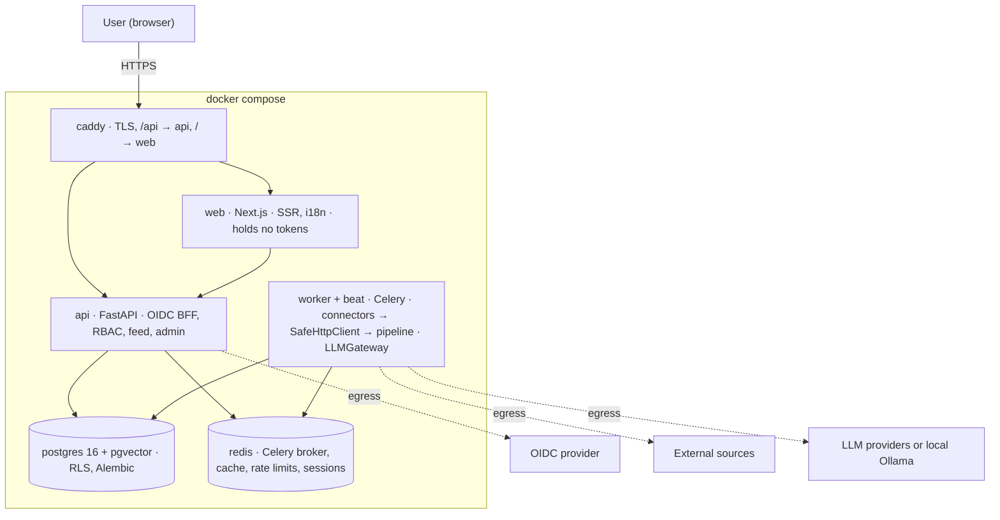

# Pharos architecture

Status: v0 (milestone M1). Describes the intended system; sections marked *planned* are not implemented yet.
Decisions behind it live in [`docs/adr/`](adr/). Where this file and an accepted ADR disagree, the ADR wins.

## 1. Shape of the system

Pharos is a **modular monolith**: one FastAPI backend package (`pharos`), run as two processes (`api` and `worker`), plus PostgreSQL 16 with pgvector, Redis, a Next.js frontend and Caddy as the edge proxy. There are no microservices (ADR-0001).



Dashed arrows are the only traffic that leaves the compose networks (default-deny egress).

- **User requests** never call an LLM. If an insight is not ready, the card shows "being prepared" and a job is queued.
- **Collection** runs on a schedule: beat → worker → connector → pipeline → PostgreSQL.
- **api and worker share the same Python package** and differ only in entry point: `uvicorn --factory pharos.main:create_app` for the API, `celery --app pharos.workers.entrypoint worker` and `... beat` for background work (`make worker`, `make beat` locally).
- **Heartbeat:** beat schedules `pharos.heartbeat` every 60 seconds and a worker writes the current time to Redis (`pharos:worker:heartbeat`); a worker also writes one when it starts. `/readyz` treats the worker as alive while that timestamp is at most 210 seconds old. A fresh timestamp proves beat, broker and worker all work. Tasks are JSON-only, acknowledged late and must be idempotent, because a task is redelivered if its worker dies.
- **Local LLM**: Ollama runs inside compose (profile `local-llm`), and cloud LLM egress is closed when it is selected.

## 2. Backend layout

```text
backend/src/pharos/
├── core/        config, db session, RLS helper, security, logging
├── auth/        OIDC (any provider, Entra preset), sessions, local accounts
├── orgs/ users/ onboarding/
├── sources/     source management, connector registry
├── ingestion/   fetch and normalization tasks
├── content/     items, dedup, embeddings
├── enrichment/  enrichment and insight tasks
├── llm/         LLMGateway, prompts, budget
├── feed/        ranking, cache, cursor pagination
├── admin/ audit/
└── workers/     Celery app, beat schedule
```

Each module has `router.py → service.py → repository.py`, plus `schemas.py` and `models.py`.

- A router holds no SQL and no business logic.
- A service never imports FastAPI.
- A module never touches another module's repository.

These rules are enforced in CI with `import-linter` (*planned*, M1-05).

`connectors/` is a separate Python package (`pharos-connectors`) discovered through entry points; the `SourceConnector` protocol lives in a small SDK package (ADR-0006, *planned* for M3).

## 3. Content pipeline

Six idempotent Celery tasks. The LLM is called in three of them and has no tools: delimited text in, schema-validated JSON out.

1. **Collect** — `connector.fetch(since)`; all HTTP goes through `SafeHttpClient` → `raw_items`.
2. **Normalize** — canonical URL (tracking parameters removed), `url_hash` → `items`.
3. **Cheap filter** (LLM #1) — rules and embedding similarity first; only uncertain items reach a small model.
4. **Cluster** — embedding similarity above a threshold assigns a shared `cluster_id`. Items are grouped, never merged.
5. **Enrich** (LLM #2, strong model) — summary, category, profession relevance, quality score.
6. **Insight** (LLM #3, strong model, lazy) — for `(item, profession, language, prompt_version)`: summary, how to apply, "Try this" prompt, data-safety note.

Cost control: insights are generated only for profession/language pairs that have active users and only for items that reach a feed. The AI level is not part of the cache key. A budget check runs in `LLMGateway`: at 80% the admin is warned, at 100% new generation stops while cached insights keep being served.

## 4. Tenancy

One installation serves one organization, but the code is tenant-aware (ADR-0005).

| Plane | Contents | Rule |
| --- | --- | --- |
| Content (public) | global sources, items, embeddings, insights | `scope='public'`, `owner_org_id` is null |
| Organization-owned content | items from an organization's own sources | `scope='org'`, `owner_org_id` NOT NULL |
| Tenant | users, profiles, interactions, LLM config and usage, audit | `org_id` NOT NULL, RLS |

`org_id` comes only from the authenticated session. Each transaction sets `app.org_id` with `set_config(..., true)`; PostgreSQL row-level security is the second line of defence. The application role does not own the tables and cannot bypass RLS; migrations run with a separate role. See [DATA_MODEL.md](DATA_MODEL.md).

## 5. Authentication

The backend is the BFF (ADR-0003): OIDC Authorization Code with PKCE, `state` and `nonce`, issuer and audience checks, server-side sessions in Redis, and an httpOnly, Secure, SameSite=Lax cookie. Tokens never reach the browser. Entra ID is the first preset; Keycloak is used in dev and E2E tests; local accounts are the fallback. LDAP and SAML are phase 2.

## 6. Frontend

Next.js App Router, TypeScript, Tailwind, shadcn/ui, `next-intl` (ADR-0008). The frontend is presentation only: authentication, authorization and business rules live in the backend, and the browser calls `/api` on the same origin. Locales: `en` (source and fallback), `az`, `tr`, `ru`.

- **Language routing:** every URL starts with the language (`/en`, `/az`, `/tr`, `/ru`). `src/proxy.ts` redirects a path without one: a supported browser language wins, otherwise the installation default applies. The default is `PHAROS_DEFAULT_LOCALE`, read at runtime, so one image serves installations with different defaults.
- **Missing translations:** `scripts/check-i18n.mjs` fails `pnpm build` and `pnpm lint` when a locale lacks a key, has an empty value, has an extra key or uses different placeholders than `en`. At runtime, a gap would still fall back to the English text instead of showing a raw key. `useTranslations` keys are type-checked against `messages/en.json`.
- **Accessibility:** Playwright runs axe (WCAG 2.2 AA) on every language, in light and dark themes, on a desktop and a phone viewport; the skip link and language navigation are tested with the keyboard.
- **Serving:** the production build uses Next's `standalone` output, started with `pnpm start` (`scripts/start-standalone.mjs`) and configured by `PORT`, `HOSTNAME` and `PHAROS_DEFAULT_LOCALE`. The web app answers `/healthz`; the backend answers `/api/healthz` and `/api/readyz`.
- **Hard-coded text** in components is rejected by the `react/jsx-no-literals` lint rule.

## 7. Deployment

One `deploy/docker-compose.yml`, three networks (edge, internal, egress) and optional profiles `dev` (Keycloak), `local-llm` (Ollama) and `observability` (OpenTelemetry, Prometheus, Grafana). PostgreSQL and Redis sit on the internal network only. Images are slim and run as non-root. TLS is automatic ACME for public domains, or `tls internal` / a custom certificate for private ones.

| Service | Networks | Egress |
| --- | --- | --- |
| caddy | edge | — |
| web | edge | — |
| api | edge, internal, egress | OIDC provider only |
| worker, beat | internal, egress | sources and LLM providers only |
| migrate | internal | — (one-shot, operator-approved in production) |
| postgres, redis | internal | none |

Health: `/healthz` (process) and `/readyz` (database, Redis, migration version, worker heartbeat).

## 8. Differences from the planning documents

| Topic | Planning document | In force |
| --- | --- | --- |
| Default UI language | `az` (PLAN, MASTER_PROMPT) | `en`; each installation chooses its own default (ADR-0008) |
| Tooling layout | PLAN §7 lists more agents, `commands/` and different skill names | The `.claude/` package in the repository |
| Metrics for the heartbeat | "visible in metrics" | Written to Redis and shown in `/readyz`; Prometheus metrics come with the `observability` profile |
| Anonymous idea pool | "admins cannot see it" | Not claimed until a design proves it (phase 2) |

## 9. Not covered yet

Backup and restore procedure, log retention defaults, embedding model choice (ADR-0007) and the load-test profile are open; see `docs/ARCHITECTURE_PROPOSAL.md` §16.
