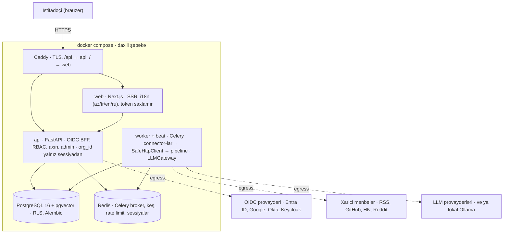
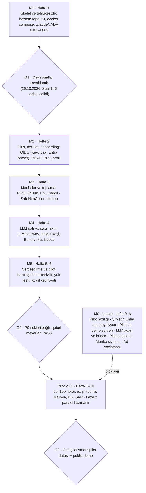

# Pharos — Arxitektura Təklifi və İcra Planı

**Versiya:** 1.3 · 26 oktyabr 2026 (qlobal auditoriya, Apache-2.0, öz şirkətinizdə pilot, Claude Code paketi)
**Depodakı yeri:** `docs/ARCHITECTURE_PROPOSAL.md`
**Status:** Sual 1–6 üzrə qərarlar qəbul edilib. Qalan texniki seçimlər ADR ilə təsdiqlənənə qədər təklif olaraq qalır.
**Əlaqəli sənədlər:** `docs/PLAN.md` (məhsul planı), `PHAROS_MASTER_PROMPT.md` (iş qaydaları)

---

## Qəbul edilmiş qərarlar (26 oktyabr 2026)

Bu qərarlar Claude Code-un ilk sessiyasında yenidən soruşulmamalıdır. ADR-0003, ADR-0005 və ADR-0008 M1-də `Accepted` statusu ilə yazılır.

**Layihə konteksti.** Pharos şəxsi açıq mənbə layihəsidir. Əvvəl öz şirkətinizdə pilot edilir, sonra istənilən şirkət onu öz serverində pulsuz quraşdıra bilər. Hüquqi məhdudiyyət yoxdur. PLAN §12-dəki “şirkətdə AD + Microsoft 365 var” və “pilot: Maliyyə, HR, SAP” pilot şirkətinin profilidir; məhsulun özü heç bir konkret şirkətin mühitinə bağlanmır.

1. **AI alətləri.** Hər təşkilatın admini icazəli AI alətlərinin siyahısını (ad + URL) təyin edir və “Bunu yoxla” onu açır. Siyahı boşdursa, yalnız kopyalama və data xəbərdarlığı göstərilir.
2. **Tenancy.** Bir quraşdırma = bir təşkilat: hər şirkət öz nüsxəsini qurur. Kod tenant-aware olur və RLS ilə qorunur; hosted multi-tenant SaaS MVP-də yoxdur (ADR-0005).
3. **Giriş.** İstənilən OIDC provayderi (Entra ID, Google Workspace, Okta, Keycloak) + lokal hesablar. Entra ID ilk hazır preset-dir (Graph-dan şöbə və vəzifə). İnkişaf və E2E testlər üçün compose-da Keycloak. LDAP və SAML Faza 2-dədir (ADR-0003).
4. **Hosting.** Deploy istənilən serverdə işləyir. Public domendə Caddy avtomatik HTTPS (ACME) verir; daxili şəbəkədə öz sertifikatı və ya `tls internal` istifadə olunur. İstinad quraşdırması: bir Linux VM + Docker Compose.
5. **LLM.** BYOK: admin provayderi, modeli və açarı özü seçir; layihə heç bir ödənişli provayderi default etmir. Testlər, CI və demo üçün deterministik fake provayder var; lokal seçim Ollama-dır.
6. **Repo.** İlk gündən public. Sirr gigiyenası ilk commit-dən başlayır: gitleaks pre-commit, yalnız saxta data. Lisenziya Apache-2.0-dır (qərar 8).
7. **Dil (qlobal auditoriya).** Repo-dakı kod, şərhlər, commit-lər, PR-lar, issue-lar, README, ADR-lər və yeni sənədlər ingilis dilindədir. UI 4 dildə gəlir (en, az, tr, ru); i18n açarlarının mənbə dili və fallback en-dir. Məhsulun default dili en-dir, hər quraşdırma öz default dilini seçir (pilot: az). Mövcud planlama sənədləri (`docs/PLAN.md`, `PHAROS_MASTER_PROMPT.md`, bu sənəd) orijinal dillərində qalır; MASTER_PROMPT-un ingilis versiyası G3-dən əvvəl hazırlanır. Claude Code istifadəçi ilə Azərbaycan dilində danışır (ADR-0008).
8. **Lisenziya.** Gəlir modeli planlaşdırılmır; Apache-2.0 qəti seçimdir. Töhfələr DCO ilə (`git commit -s`) qəbul olunur, CLA lazım deyil.
9. **Pilot.** Öz şirkətiniz: Entra ID + Microsoft 365, Maliyyə, HR və SAP komandaları, 50–100 nəfər. Pilotun ilkin şərtləri (şirkət Entra ID-sində app registration, pilot serveri, LLM API açarı və büdcə, icazəli AI aləti) M5-ə qədər hazır olmalıdır, amma inkişafı bloklamır. Pilot şirkətinin konfiqurasiyası və datası yalnız quraşdırmanın `.env`-ində və admin panelində saxlanılır, public repo-ya düşmür.

---

## 1. Xülasə

Tövsiyə: Pharos **modul monolit** kimi qurulsun. Tərkib: bir FastAPI backend, eyni kodu istifadə edən Celery worker, PostgreSQL 16 + pgvector, Redis, Next.js və Caddy. Mikroservis lazım deyil: 30.000 istifadəçi bu yükü daşıyır, kiçik komanda üçün idarəsi isə xeyli asandır.

İki mənbə sənəd ümumən uyğundur, amma 10 ziddiyyət və boşluq var. Ən kritik 5 məqam:

1. **Tenant modeli ilə xərc qaydası toqquşur.** PLAN həm “hər cədvəldə org_id”, həm də LLM nəticələrinin təşkilatlar arasında paylaşılmasını istəyir. Həll: ictimai məzmun üçün paylaşılan “content plane”, şirkət məlumatı üçün RLS ilə qorunan “tenant plane”.
2. **“Bunu yoxla” promptu məlumat sızmasına yol aça bilər.** Maliyyə və HR istifadəçisi promptu icazəsiz xarici AI alətinə şirkət datası ilə yapışdıra bilər. Hər kart təşkilat admininin təyin etdiyi icazəli alətə yönləndirməli və data xəbərdarlığı daşımalıdır.
3. **Kritik yol kod yox, pilot hazırlığıdır.** Kod Keycloak və fake LLM provayderi ilə tam lokal inkişaf etdirilir və heç bir xarici təsdiq gözləmir. Pilot üçün isə şirkətinizin Entra ID qeydiyyatı, serveri və LLM büdcəsi M5-ə qədər hazır olmalıdır.
4. **LLM xərci peşə × dil × məzmun sayı ilə böyüyür.** Insight yalnız aktiv istifadəçisi olan peşə/dil cütləri üçün və yalnız seçilmiş məzmuna “lazy” yaradılmalıdır.
5. **Hədəf bir şirkət yox, çox şirkətdir.** Giriş istənilən OIDC provayderi ilə, LLM təşkilatın öz açarı ilə (BYOK), deploy isə istənilən serverdə işləməlidir. Repo ilk gündən public olur.

## 2. Sənədlərin təhlili: ziddiyyətlər və boşluqlar

`PLAN.md` məhsulu yaxşı təsvir edir, `PHAROS_MASTER_PROMPT.md` isə iş qaydalarını gücləndirir. Problem onların bir-birinə və özlərinə qarşı 10 nöqtədə uyğunsuz olmasıdır.

| # | Mövzu | Ziddiyyət və ya boşluq | Təklif olunan həll |
| --- | --- | --- | --- |
| 1 | Qaydaların üstünlük sırası | MASTER-də ADR-lər PLAN-dan aşağıdadır, halbuki texniki qərar məhz ADR ilə dəyişir. MASTER faylının özü bu sırada yoxdur. | Məhsul əhatəsində PLAN, texniki seçimdə qüvvədə olan ADR üstündür. MASTER = CLAUDE.md-nin genişləndirilməsi. |
| 2 | İki “ilk prompt” | PLAN §10 (5 ekspert, TASKS.md-yə yaz) və MASTER §15 (7 baxış, TASKS-ı kütləvi yazma) fərqlidir. | MASTER §15 qalır; PLAN §10 ona istinadla əvəzlənir. |
| 3 | Ehtiyat giriş üsulu | §2: e-poçt; §3 və §12: LDAP; §3 əlavə olaraq Google, Keycloak, lokal hesab. | Qərar: istənilən OIDC provayderi + lokal hesablar; LDAP və SAML Faza 2. |
| 4 | org_id hər yerdə vs paylaşılan keş | “Bütün cədvəllərdə org_id” ilə “insight peşə + dil üzrə paylaşılır” bir-birini istisna edir. MASTER keş açarına tenant əlavə etməyi tələb edir. | İki səthli model: content plane + tenant plane (Bölmə 5). |
| 5 | org_id-nin mənbəyi | CLAUDE.md filtri məcburi edir, amma dəyərin haradan gəldiyini demir. | org_id yalnız sessiyadan götürülür; PostgreSQL RLS ikinci müdafiə xəttidir. |
| 6 | Anonim fikir hovuzu | “Admin belə görə bilməz” iddiası self-hosted-də sübut olunmur: admin həm DB-yə, həm şifrələmə açarına çıxışa malikdir. | Faza 2-də ayrıca dizayn. Sübut olunana qədər UI-da bu iddia yazılmır. |
| 7 | İmzalı commit və DCO | Branch qoruması “imzalı commit” (GPG/SSH), CONTRIBUTING isə DCO (`git commit -s`) tələb edir; bunlar fərqli şeylərdir. | Xarici töhfəçilər üçün yalnız DCO; maintainer-lər üçün imzalı commit. |
| 8 | MASTER faylı strukturda yoxdur | PLAN §7 ağacında `PHAROS_MASTER_PROMPT.md` göstərilməyib. | Kökə əlavə edilir, CLAUDE.md-dən istinad olunur. |
| 9 | “3 əmrlə quraşdırma” | Kimlik provayderi (IdP) konfiqurasiya olunmadan real giriş işləmir. | 3 əmrlə “demo rejimi” (lokal hesab + nümunə məzmun); istehsal quraşdırması ayrıca bələdçi ilə. |
| 10 | Admin paneli | LLM provayderi, büdcə, mənbələr və brendinq “admin paneldən” idarə olunur, amma admin paneli MVP siyahısında yoxdur. | MVP-yə minimal admin paneli əlavə edilir. |

Hər iki sənəddə olmayan, amma MVP üçün lazım olan mövzular:

- Backup, bərpa və log saxlama müddəti.
- Worker-in internetə çıxış siyasəti (egress allowlist).
- Embedding modeli və onun ölçüsü (məzmun 4 dildədir, çoxdilli model şərtdir).
- Xarici məzmunun saxlanma qaydası: tam mətn yox, başlıq + qısa çıxarış + link (müəllif hüquqları).
- Azərbaycan dilində LLM çıxışının keyfiyyət qiymətləndirməsi.
- Peşə taksonomiyasının sahibi və strukturu.
- Analitika hadisələri: metrikalar (WAU, “Bunu yoxla” klikləri) üçün nə toplanır, necə anonimləşdirilir.
- `PLAN.md` sanitizasiya üçün `bleach` göstərir; bu kitabxana köhnəlmiş (deprecated) sayılır, `nh3` tövsiyə olunur.

## 3. Arxitektura prinsipləri

Aşağıdakı 9 prinsip bütün sonrakı qərarları istiqamətləndirir; hər biri ADR və ya test ilə yoxlanılır.

1. **Modul monolit.** Bir backend kod bazası, aydın modul sərhədləri; ayrı servis yalnız ölçülmüş ehtiyac olduqda.
2. **İki səth.** İctimai məzmun (content plane) bir dəfə emal olunur və paylaşılır; şirkət məlumatı (tenant plane) org_id + RLS ilə izolə olunur.
3. **LLM-in aləti yoxdur.** Model yalnız mətn alır və schema ilə yoxlanan JSON qaytarır; heç bir funksiya, shell və ya SQL çağırmır.
4. **Bir HTTP qapısı.** Xarici sorğuların hamısı `SafeHttpClient`-dən keçir (SSRF qoruması, timeout, ölçü limiti).
5. **Default-deny egress.** Yalnız worker və API, yalnız icazəli ünvanlara internetə çıxır; DB və Redis-in internetə çıxışı yoxdur.
6. **Konfiqurasiya, kod yox.** Model, provayder, mənbə və büdcə dəyişikliyi kod dəyişikliyi tələb etmir.
7. **İdempotent pipeline.** Hər mərhələ təkrar işə salına bilər; dublikat emal nəticəni dəyişmir.
8. **Sübutsuz məxfilik iddiası yoxdur.** “Anonimdir”, “xaricə çıxmır” kimi ifadələr yalnız test və arxitektura ilə təsdiqlənəndə yazılır.
9. **Sadə quraşdırma.** Bir `docker-compose.yml`, opsional hissələr profillərlə (lokal LLM, monitoring).

## 4. Sistem arxitekturası

API istifadəçi sorğularına cavab verir və internetə yalnız OIDC provayderi üçün çıxır; toplama və bütün LLM çağırışları worker-dədir. Bu ayrılıq egress qaydalarını sadələşdirir və istifadəçi sorğusunu LLM gecikməsindən qoruyur.



Qırıq xətli oxlar şəbəkədən çıxan yeganə çağırışlardır (egress allowlist).

- **İstifadəçi axını.** Brauzer → Caddy → web/api → PostgreSQL (RLS) və Redis keşi. Axın sorğusunda LLM çağırılmır; insight hazır deyilsə, kartda “hazırlanır” görünür və iş növbəyə düşür.
- **Toplama axını.** beat cədvəli → worker → connector → pipeline → PostgreSQL.
- **Lokal LLM.** Ollama seçiləndə o, compose daxilində (profil `local-llm`) işləyir və bulud LLM egress-i bağlanır.
- **Paylaşılan kod.** api və worker eyni Python paketidir (`pharos`), fərqli giriş nöqtələri ilə işə düşür.

## 5. Multi-tenancy və məlumat modeli

Qərar: bir quraşdırma = bir təşkilat (MVP), amma kod əvvəldən tenant-aware olur və PostgreSQL RLS ilə qorunur. İctimai məzmun və onun LLM nəticələri bütün təşkilatlar üçün bir dəfə yaradılır; bu, PLAN-dakı xərc qaydasını tenant izolyasiyası ilə barışdırır.

| Səth | Cədvəllər | org_id qaydası | Qoruma |
| --- | --- | --- | --- |
| Content plane (ictimai) | `sources` (scope=global), `raw_items`, `items`, `item_embeddings`, `item_professions`, `item_insights` | `scope='public'`, `owner_org_id` boş | İstifadəçi və şirkət məlumatı burada heç vaxt saxlanmır |
| Şirkətə məxsus məzmun | Təşkilatın öz mənbələrindən gələn `items` və onların insight-ları | `scope='org'`, `owner_org_id` NOT NULL (CHECK constraint) | RLS: `scope='public' OR owner_org_id = cari org` |
| Tenant plane | `organizations`, `users`, `departments`, `user_profiles`, `user_sources`, `interactions`, `llm_provider_configs`, `llm_usage`, `audit_logs`, Faza 2 cədvəlləri | NOT NULL | RLS + servis qatında yoxlama; org_id yalnız sessiyadan |

RLS mexanizmi: hər tranzaksiyanın əvvəlində API `app.org_id` sessiya parametrini (`SET LOCAL` və ya `set_config(..., true)`) sessiyadakı org-a bərabər edir. Tətbiq rolu cədvəl sahibi deyil, ona görə RLS-dən yan keçə bilmir. Migration-lar ayrı, daha geniş hüquqlu rol ilə işləyir.

### Əsas cədvəllər

| Cədvəl | Əsas sahələr | Qeyd |
| --- | --- | --- |
| `organizations` | id, name, slug, settings (jsonb: brendinq, dil, siyasətlər) | Bir quraşdırmada adətən 1 sətir |
| `users` | id, org_id, entra_oid, email, display_name, department_id, locale, role, status | Rol: admin, editor, member |
| `professions` | id, org_id (boş = qlobal), code, names (jsonb: az/tr/en/ru), parent_id | Qlobal taksonomiya + təşkilatın öz peşələri |
| `user_profiles` | user_id, org_id, profession_id, ai_level, interests | Onboarding nəticəsi |
| `sources` | id, scope, owner_org_id, connector_id, config_encrypted, schedule, enabled, last_fetched_at | Connector konfiqurasiyası şifrəli |
| `raw_items` | id, source_id, external_id, url, payload (jsonb), fetched_at | Müvəqqəti; təklif: 30 gün saxlanır |
| `items` | id, scope, owner_org_id, canonical_url, url_hash (unikal), title, excerpt, lang, published_at, quality_score, cluster_id, status | Tam mətn saxlanmır, yalnız qısa çıxarış |
| `item_embeddings` | item_id, model, dim, embedding (vector) | Model dəyişəndə yenidən hesablanır |
| `item_professions` | item_id, profession_id, relevance | Zənginləşdirmə mərhələsinin nəticəsi |
| `item_insights` | item_id, profession_id, language, prompt_version, model, summary, how_to_apply, try_prompt, safety_note, status | Unikal: (item, peşə, dil, prompt_version) |
| `interactions` | org_id, user_id, item_id, type, value, created_at | view, save, useful, not_useful, tried, time_saved |
| `llm_provider_configs` | org_id, provider, stage_model_map, api_key_encrypted, key_version | Açar rotasiyası üçün key_version |
| `llm_usage` | org_id, stage, provider, model, tokens_in, tokens_out, cost_estimate, created_at | Büdcə və hesabat; məzmun saxlanmır |
| `audit_logs` | org_id, actor_id, action, target, ip_hash, created_at | Sirr və məzmun yazılmır |

## 6. Məzmun və LLM pipeline-ı

Pipeline 6 mərhələdən ibarətdir, hər mərhələ ayrıca idempotent Celery task-dır. LLM yalnız 3 mərhələdə çağırılır və heç bir alətə çıxışı yoxdur.

1. **Toplama.** Connector cədvəl üzrə `fetch(since)` çağırır, bütün HTTP `SafeHttpClient`-dən keçir → `raw_items`.
2. **Normallaşdırma.** URL kanonikləşdirilir (utm və izləmə parametrləri silinir), `url_hash` hesablanır → `items`. Eyni URL burada düşür.
3. **Ucuz filtr (LLM #1).** Əvvəl qaydalar (dil, uzunluq, açar sözlər) və embedding oxşarlığı; yalnız qeyri-müəyyən hallar kiçik modelə gedir.
4. **Semantik qruplaşdırma.** Embedding oxşarlığı həddən yuxarıdırsa, item-lər eyni `cluster_id` alır. Birləşdirmə yox, qruplaşdırma: səhv uyğunluq məzmun itirmir. Hədd qiymətləndirmə dəsti ilə tənzimlənir.
5. **Zənginləşdirmə (LLM #2, güclü model).** Kanonik xülasə, kateqoriya, peşə uyğunluq balları, keyfiyyət balı → JSON schema ilə yoxlanır.
6. **Insight (LLM #3, güclü model, lazy).** (item, peşə, dil, prompt_version) üçün: 2 cümləlik xülasə, “sənin işində necə”, “Bunu yoxla” promptu, data təhlükəsizliyi qeydi.

### Xərc modeli

Gündəlik insight çağırışı ≈ (hər peşə üçün gündə seçilən item sayı) × (aktiv peşə sayı) × (aktiv dil sayı). Pilot üçün nümunə (fərziyyə, təsdiqlənməyib): 20 × 15 × 2 = 600 çağırış/gün.

- AI səviyyəsini (başlanğıc/orta/irəli) keş açarına əlavə etsək, say 3 dəfə artır. Tövsiyə: səviyyə açarda olmasın, yalnız sıralamaya və kartdakı izahın tonuna təsir etsin.
- Insight yalnız istifadəçisi olan peşə/dil cütləri üçün yaradılır; axında olmayan item üçün heç vaxt.
- Prompt versiyası dəyişəndə köhnə insight-lar toplu yenilənmir, baxılanda yenilənir.
- Büdcə: `llm_usage` + Redis sayğacı. 80%-də admin xəbərdarlığı, 100%-də yeni generasiya dayanır, mövcud keş göstərilməyə davam edir.

### LLMGateway (LiteLLM üzərində)

Tətbiq kodu LiteLLM-i birbaşa çağırmır; hər çağırış daxili `LLMGateway` modulundan keçir. Gateway bunları edir: büdcə yoxlaması, mərhələ → model xəritəsi (konfiqdən), şirkət məzmunu üçün maskalama, timeout və retry/backoff, JSON schema doğrulaması, həssas məlumatsız telemetriya. Tövsiyə: MVP-də LiteLLM Python SDK, ayrıca LiteLLM Proxy servisi yox (bir servis az; ADR-0002).

### Prompt injection və məzmun zəhərlənməsi

- Xarici mətn açıq ayırıcılar arasında, “data” kimi verilir; sistem promptu onu təlimat saymamağı tələb edir.
- Çıxışda yalnız mənbənin öz URL-inə icazə var; başqa linklər silinir.
- `try_prompt` yoxlanılır: link yoxdur, parol və ya şəxsi məlumat istəmir, uzunluq limiti var. Real data yerinə yer tutucular olur, məsələn `[SƏNƏDİN MƏTNİ]`.
- Aşağı keyfiyyət balı və ya şübhəli çıxış → item gizlədilir və editor növbəsinə düşür.

### Keyfiyyət və dil

- Default model seçilməzdən əvvəl Azərbaycan dilində qiymətləndirmə: 3 pilot peşəsi üzrə 30–50 item, ana dili daşıyıcıları tərəfindən 1–5 bal. Model dəyişəndə təkrarlanır.
- Kiçik lokal modellərin Azərbaycan dilində zəif ola biləcəyi ehtimalı yüksəkdir; Ollama seçimi bu testdən keçməlidir.
- Embedding modeli çoxdilli olmalıdır (az, tr, en, ru); ölçüsü sxemə yazılır, model dəyişikliyi tam yenidən hesablama tələb edir (ADR-0007).

### Mənbələr

MVP: RSS, GitHub, Hacker News, Reddit. Reddit API-nin kommersiya istifadəsi şərtləri hüquqi yoxlama tələb edir; alternativ olaraq subreddit RSS lentləri. arXiv və YouTube Faza 2-də; X default olaraq söndürülüb. Xarici məzmundan yalnız başlıq, qısa çıxarış və link saxlanılır; UI həmişə orijinala istinad edir.

## 7. Təhlükəsizlik arxitekturası

Ən böyük 4 risk sahəsi: tenant izolyasiyası, LLM məzmun zəhərlənməsi, SSRF və istifadəçinin “Bunu yoxla” vasitəsilə şirkət datasını icazəsiz alətə ötürməsi. Hər nəzarətin avtomatlaşdırılmış testi olmalıdır.

| Təhlükə | Nəzarət | Yoxlayan test |
| --- | --- | --- |
| Kimlik saxtakarlığı | OIDC Authorization Code + PKCE, state/nonce, issuer/audience yoxlaması. Backend BFF rolunda: tokenlər brauzerə düşmür. Sessiya: httpOnly, Secure, SameSite=Lax cookie, Redis-də | Saxta nonce, vaxtı keçmiş token, yanlış audience |
| Tenant escape | org_id yalnız sessiyadan; repository qatında məcburi filtr; RLS ikinci xətt | İki təşkilatlı fixture ilə hər endpoint üçün cross-tenant testi |
| Yetkisiz əməliyyat (RBAC) | admin / editor / member yoxlaması servis qatında, UI-da yox | Rol × endpoint matrisi |
| Prompt injection, məzmun zəhərlənməsi | Ayırıcılar, alətsiz LLM, JSON schema, link filtri, `try_prompt` yoxlaması, editor növbəsi | Injection korpusu ilə regresiya testi |
| “Bunu yoxla” ilə data sızması | Kartda admin-in təyin etdiyi icazəli AI alətinə düymə + “həssas məlumat yapışdırma” xəbərdarlığı; promptda yer tutucular | UX review + pilot təlimi |
| SSRF | `SafeHttpClient`: http/https allowlist, DNS həlli və private/loopback/link-local/metadata bloku, hər redirect-də yenidən yoxlama, timeout, ölçü limiti | 169.254.169.254, DNS rebinding, redirect zənciri |
| XSS | LLM çıxışı düz mətn və ya məhdud markdown; server tərəfdə `nh3`; sərt CSP; React escaping | Zərərli HTML/markdown korpusu |
| CSRF | Same-origin (Caddy arxasında), SameSite=Lax + dəyişdirici sorğularda CSRF token | Başqa origin-dən POST |
| Sirlərin sızması | API açarları AES-256-GCM ilə (envelope), master açar Docker secret/env-dən, `key_version` ilə rotasiya; log maskalama filtri; gitleaks | Loglarda açar nümunəsi axtarışı |
| DoS və xərc hücumu | İstifadəçi və təşkilat üzrə rate limit (Redis), LLM büdcəsi, növbə backpressure | Limit aşımı testləri |
| Təchizat zənciri | Lockfile-lar (`uv.lock`, `pnpm-lock.yaml`), Dependabot, CodeQL, Trivy, SBOM; image imzası M5-də | CI-da məcburi yoxlamalar |

Audit edilən hadisələr: giriş və çıxış, rol dəyişikliyi, LLM ayarları və açarları, mənbə əlavəsi/silinməsi, export, büdcə dəyişikliyi. Audit qeydində məzmun və sirr olmur.

Şirkət məzmunu (Faza 2: fikirlər, uğur hekayələri) default olaraq bulud LLM-ə getmir. Admin açarsa, maskalama (e-poçt, telefon, FİN, IBAN, şəxs adları) tətbiq edilir və bu, audit-ə yazılır.

## 8. Frontend, i18n və UX

Frontend yalnız təqdimat qatıdır: autentifikasiya, icazə və biznes məntiqi backend-dədir, Next.js isə eyni origin-də `/api` çağırır.

- **Next.js App Router.** Oxuma səhifələri server komponentləri ilə. NextAuth istifadə olunmur, çünki giriş backend-də (BFF) idarə olunur; iki ayrı auth məntiqi olmasın.
- **i18n: `next-intl`.** `messages/{en,az,tr,ru}.json`; açarların mənbə dili və fallback en-dir. Məhsulun default dili en-dir, hər quraşdırma öz default dilini seçir (pilot: az). CI-da çatışmayan açar varsa build uğursuz olur.
- **Məzmun dili.** Insight istifadəçinin dilində göstərilir, orijinal dil etiketi və “orijinala bax” linki ilə.
- **Onboarding (2 dəqiqədən az).** Peşə və şöbə OIDC claim-lərindən (Entra ID üçün Graph-dan: `jobTitle`, `department`) əvvəlcədən doldurulur, istifadəçi təsdiqləyir. Addımlar: peşə → maraqlar → dil → AI səviyyəsi.
- **Kart.** Başlıq, 2 cümləlik xülasə, “sənin işində necə”, “Bunu yoxla” (kopyala + təsdiqlənmiş alətdə aç), data təhlükəsizliyi qeydi, mənbə və orijinal dil.
- **Vəziyyətlər.** Loading, boş axın, xəta, icazə yoxdur, büdcə bitib, “insight hazırlanır”. İlk quraşdırmada boş axının qarşısını almaq üçün son 30 günlük məzmun əvvəlcədən yüklənir (backfill).
- **Əlçatanlıq.** shadcn/ui (Radix əsaslı), `eslint-plugin-jsx-a11y`, Playwright-da axe yoxlaması, klaviatura ilə tam istifadə.
- **Mobil.** MVP-də mobil-first responsive; PWA və offline Faza 2-yə keçirilir.
- **Brendinq.** Loqo və rənglər `organizations.settings`-dən CSS dəyişənlərinə yazılır; kontrast WCAG AA-dan aşağı düşə bilməz.

## 9. Deploy, əməliyyat və müşahidəolunma

Bir `docker-compose.yml`, üç şəbəkə və üç opsional profil (`local-llm`, `observability`, `dev`); DB və Redis internetə heç vaxt çıxmır.

| Servis | Rol | Şəbəkə | Qeyd |
| --- | --- | --- | --- |
| `caddy` | TLS, reverse proxy | edge | ACME (public domen), öz sertifikatı və ya `tls internal` (qərar 4) |
| `web` | Next.js (standalone build) | edge | Non-root |
| `api` | FastAPI | edge, internal, egress | Egress yalnız OIDC provayderi (Entra üçün Graph) |
| `keycloak` | Lokal OIDC provayderi | internal | Profil: `dev`; yalnız inkişaf və E2E testlər üçün |
| `worker`, `beat` | Celery worker və planlaşdırıcı | internal, egress | Egress yalnız mənbələr və LLM provayderləri |
| `migrate` | Bir dəfəlik `alembic upgrade head` | internal | `api`-dən əvvəl işləyir; istehsalda operator təsdiqi ilə |
| `postgres` | PostgreSQL 16 + pgvector | internal | Həcm (volume), gecəlik backup |
| `redis` | Broker, keş, sessiyalar | internal | Parol + yalnız daxili şəbəkə |
| `ollama` | Lokal LLM | internal | Profil: `local-llm` |
| `otel`, `prometheus`, `grafana` | Monitorinq | internal | Profil: `observability` |

- **Backup.** Gecəlik `pg_dump`, saxlama təklifi: 7 gündəlik, 4 həftəlik, 3 aylıq. Hər rübdə bərpa testi; nəticə `docs/reports/`-a yazılır.
- **Log.** JSON formatda, `request_id` və `org_id` ilə; sirr maskalama filtri. Saxlama müddəti təsdiq tələb edir (Sual 10).
- **Sağlamlıq.** `/healthz` (proses), `/readyz` (DB, Redis, migration versiyası).
- **Metrikalar.** API gecikməsi, növbə uzunluğu, pipeline mərhələ xətaları, LLM token və xərc, büdcə istifadəsi.
- **Hədəflər (təklif).** Axın API p95 400 ms-dən az; iş saatlarında 99,5% əlçatanlıq. 30.000 istifadəçi M5-dəki yük testi ilə yoxlanmayınca “sübut olunmuş” sayılmır.
- **İlkin resurs təxmini.** Pilot (100 nəfər): bir VM, 4 vCPU / 16 GB / 100 GB SSD. 30.000 üçün başlanğıc təxmini: API 2 × (2 vCPU/2 GB), worker 2 × (2 vCPU/4 GB), PostgreSQL 4 vCPU/16 GB. Hər ikisi yük testi ilə dəqiqləşdirilməlidir.

## 10. Repository və Claude Code quruluşu

PLAN §7-dəki struktur əsas götürülür; aşağıdakı 3 dəyişiklik və 5 təhlükəsizlik düzəlişi əlavə olunur.

### Backend modulları

```text
backend/src/pharos/
├── core/          # config, db sessiyası, RLS, təhlükəsizlik, logging
├── auth/          # OIDC (istənilən provayder, Entra preset), sessiya, lokal hesablar
├── orgs/  users/  onboarding/
├── sources/       # mənbə idarəsi, connector reyestri
├── ingestion/     # fetch + normallaşdırma task-ları
├── content/       # items, dedup, embeddings
├── enrichment/    # zənginləşdirmə və insight task-ları
├── llm/           # LLMGateway, promptlar, büdcə
├── feed/          # sıralama, keş, cursor pagination
├── admin/  audit/
└── workers/       # Celery app, beat cədvəli
```

Hər modulda `router.py → service.py → repository.py`, üstəgəl `schemas.py` və `models.py`. Qayda: router SQL yazmır, servis FastAPI-dən import etmir, modullar bir-birinin repository-sinə toxunmur. Bu qaydalar `import-linter` ilə CI-da yoxlanılır.

### Struktur dəyişiklikləri

1. `connectors/` ayrıca Python paketi olur (`pharos-connectors`), `SourceConnector` protokolu isə kiçik SDK paketində. Yeni connector-lar Python entry point (`pharos.connectors`) ilə tapılır; icma əsas koda toxunmur.
2. Python üçün `uv` workspace (backend + connectors), frontend üçün `pnpm` (ADR-0001).
3. Kökə `PHAROS_MASTER_PROMPT.md` əlavə olunur. `CLAUDE.md` qısa qalır (200 sətirdən az) və master prompta import etmədən istinad edir, çünki `@` importu faylı hər sessiyada tam yükləyir və kontekst xərcini azaltmır. Master promptun prosedurları skill-lərə köçürülüb.

### Claude Code üzrə təhlükəsizlik düzəlişləri

1. **Deny siyahısı tək müdafiə deyil.** `rm -rf` qadağası `rm -r -f`, `find -delete` və ya `python -c` ilə yan keçilə bilər. `pre-bash-guard.sh` hook-u + devcontainer/sandbox birlikdə lazımdır.
2. **`docker compose` faktiki olaraq host-da root hüququdur.** Konteynerə host qovluğunu mount etməklə `.env` oxuna bilər. Tövsiyə: Claude Code devcontainer-də işləsin və ya `docker compose up/down` “ask” siyahısına keçsin.
3. **`docker compose config` qadağan edilməlidir**, çünki `.env` dəyərlərini açıq mətnlə çap edir.
4. **Postgres MCP** yalnız dev DB-yə, ayrıca read-only rol ilə qoşulur.
5. **GitHub MCP** tokeni yalnız bu repo üçün, minimal hüquqlu fine-grained token olmalıdır.

### Claude Code paketi (hazır)

`pharos-claude-setup.zip` repo-nun kökünə açılır. Məqsəd: əsas kontekst kiçik qalsın, rutin işi ucuz model görsün.

| Agent / sessiya | Model | Rol |
| --- | --- | --- |
| Əsas sessiya | `opusplan` (planda Opus, icrada Sonnet) | `.claude/settings.local.json`-da; şəxsi seçimdir, repo-ya düşmür |
| `architect` | Opus | Dizayn, data model, ADR qaralaması; `memory: project` |
| `security-reviewer` | Opus | Müstəqil review, fayl dəyişmir; `security-checklist` əvvəlcədən yüklənir |
| `test-writer` | Sonnet | Testlər yazır |
| `test-runner` | Haiku | Test və lint işə salır, 25 sətirlik xülasə qaytarır |
| `docs-keeper` | Haiku | TASKS, PROGRESS, CHANGELOG və sessiya qeydləri |
| `Explore` | Haiku | Daxili Explore agentini ucuz modellə əvəz edir |

Skill-lər yalnız lazım olanda yüklənir: `session-start`, `session-handoff`, `definition-of-done`, `security-checklist`, `adr`, `new-connector`, `progress-report`. `.claude/rules/` altındakı backend, frontend və LLM qaydaları yalnız uyğun fayllara toxunanda yüklənir. Yaddaş üç qatdır: CLAUDE.md (qaydalar), Claude Code-un auto memory-si və repo-dakı `docs/sessions/` + `TASKS.md`.

## 11. Risk reyestri

Yalnız 1 risk P0-dır: “Bunu yoxla” ilə data sızması. Hüquqi və İT asılılıqları layihənin şəxsi açıq mənbə olması ilə aradan qalxdı; yerinə pilot və çox-provayder riskləri gəldi.

| ID | Prioritet | Risk | Təsir | Ehtimal | Azaldıcı tədbir | Kimin qərarı |
| --- | --- | --- | --- | --- | --- | --- |
| R1 | P0 | “Bunu yoxla” ilə həssas datanın icazəsiz AI alətinə ötürülməsi | Müştəri şirkətin datasının sızması | Orta | Admin-in təyin etdiyi icazəli alət, xəbərdarlıq, yer tutucular, istifadəçi təlimi materialı | Hər quraşdırmanın admini |
| R2 | P1 | Pilot hazırlığının gecikməsi (Entra ID qeydiyyatı, server, LLM büdcəsi) | Pilot sürüşür | Orta | Şirkətdaxili müraciətləri M3-dən əvvəl göndərmək; inkişaf Keycloak ilə gedir | Layihə sahibi + şirkət İT |
| R3 | P1 | Public repo-ya sirr və ya şəxsi data düşməsi | Sızma; git tarixçəsindən silmək çətindir | Aşağı | gitleaks pre-commit + CI, yalnız saxta data, `.env.example` | — |
| R4 | P1 | LLM məzmun zəhərlənməsi (prompt injection) | Yanlış və ya zərərli tövsiyə | Orta | Alətsiz LLM, schema, link filtri, editor növbəsi | — |
| R5 | P1 | LLM xərcinin gözləniləndən çox olması | Müştərinin büdcəsi aşılır | Orta | Lazy insight, ucuz filtr, sərt büdcə limiti | Hər quraşdırmanın admini |
| R6 | P1 | Azərbaycan dilində çıxış keyfiyyətinin zəif olması | İstifadəçi qəbulu düşür | Yüksək | Qiymətləndirmə dəsti, modelin ona görə tövsiyə edilməsi | Layihə sahibi |
| R7 | P1 | Mənbələrin ToS/API məhdudiyyətləri | Connector bağlanır | Orta | RSS alternativi, ToS yoxlaması | Layihə sahibi |
| R8 | P1 | İstifadəçi mənbələri vasitəsilə SSRF | Müştərinin daxili şəbəkəsinə çıxış | Aşağı | `SafeHttpClient`, egress allowlist | — |
| R9 | P1 | 5 həftəlik qrafikin real olmaması | Pilot gecikir | Yüksək | M5-i 2 həftə etmək, əhatəni kəsmək | Layihə sahibi |
| R10 | P2 | OIDC provayderləri arasındakı fərqlər (claim adları, şöbə məlumatı) | Giriş bəzi şirkətlərdə işləmir | Orta | Konfiqurasiya olunan claim mapping; Keycloak və Entra ID ilə E2E | — |
| R11 | P2 | Claude Code icazələrinin yan keçilməsi | Sirr sızması, data itkisi | Orta | Hook + devcontainer | — |
| R12 | P2 | İlk quraşdırmada boş axın | Pis ilk təəssürat | Yüksək | 30 günlük backfill, nümunə məzmun | — |
| R13 | P2 | Özü bildirdiyi vaxt qənaətinin etibarsızlığı | Rəhbərlik hesabatı zəifləyir | Yüksək | Diapazon seçimi, pilot sorğusu ilə müqayisə | — |
| R14 | P2 | Quraşdıranların backup etməməsi | Müştəri datasını itirir | Orta | Compose-da hazır backup servisi, bərpa bələdçisi | — |
| R15 | P2 | “Pharos” adının başqa layihə və ya ticarət nişanı ilə toqquşması | Lansmandan sonra ad dəyişikliyi | Orta | GitHub, PyPI, npm, domen və ticarət nişanı yoxlaması | Layihə sahibi |
| R16 | P3 | LiteLLM və digər asılılıqların sürətli dəyişməsi | Build və ya inteqrasiya sınır | Orta | Versiya pin, Dependabot, inteqrasiya testləri | — |

## 12. İcra planı və kritik yol

Tövsiyə: pilot PLAN-dakı kimi 5-ci deyil, 7-ci həftədə başlasın. Əlavə həftə təhlükəsizlik testləri, yük testi və Azərbaycan dili keyfiyyət yoxlaması üçündür.



M1–M5 Keycloak və fake LLM ilə tam lokal işləyir; M0 yalnız pilotu bloklayır.

PLAN-dan fərqlər:

- M0 əlavə edildi: pilot hazırlığı 1-ci gündən paralel gedir. Kod tərəfi Keycloak və fake LLM ilə heç bir xarici asılılıq gözləmir.
- M5 iki həftədir; pilot G2 yoxlamasından keçmədən başlamır.
- Repo ilk gündən public-dir; geniş lansman (Show HN, Product Hunt və s.) pilot datasından sonra, G3-də edilir.
- Faza 2 (fikir hovuzu, uğur hekayələri, nişanlar) pilot zamanı hazırlanır, amma pilot əhatəsinə daxil edilmir.
- Qrafik bir developer + Claude Code fərziyyəsi ilədir; komanda ölçüsü təsdiqlənəndə yenidən hesablanır (Sual 7).
- Claude Code-a hər dəfə yalnız cari milestone verilir.

## 13. Milestone 1: detallı task-lar

M1 = 10 kod task-ı + 5 paralel qərar task-ı; təxmini 5 iş günü (bir developer + Claude Code). M1-in sonunda biznes funksiyası yoxdur, amma təhlükəsiz, test olunan və deploy edilə bilən baza var.

### M0: paralel işlər (sahibi: layihə sahibi)

- [ ] M0-01 — Pilot üçün şirkətdaxili razılıq və pilot komandaları (Maliyyə, HR, SAP; 50–100 nəfər)
- [ ] M0-02 — Şirkətin Entra ID-sində app registration (M5-ə qədər; inkişaf Keycloak ilə gedir)
- [ ] M0-03 — Pilot serveri (şirkətdaxili) və public demo üçün ayrıca server və domen
- [ ] M0-04 — Dev üçün şəxsi LLM test açarı; pilot üçün şirkətin LLM API açarı, aylıq büdcəsi və icazəli AI aləti
- [ ] M0-05 — Pilot peşələri, ilkin mənbə siyahısı və “Pharos” adının yoxlanması (GitHub, PyPI, npm, domen)

### M1: kod task-ları

| ID | Status | Task | Asılılıq | Qəbul meyarı | Yoxlama |
| --- | --- | --- | --- | --- | --- |
| M1-01 | Todo | Repo skeleti və Makefile | — | Qovluq ağacı ARCHITECTURE.md ilə eynidir; `make help` bütün hədəfləri göstərir | Manual review |
| M1-02 | Todo | ADR 0001–0009, ARCHITECTURE.md, DATA_MODEL.md, THREAT_MODEL.md v0 | M1-01 | ADR-lər ingilis dilində; hər birində kontekst, variantlar, qərar, nəticə, status; 0003, 0005 və 0008 `Accepted`, qalanları `Proposed` | markdownlint |
| M1-03 | Todo | OSS faylları: LICENSE, README, CONTRIBUTING (DCO), CODE_OF_CONDUCT, SECURITY, GOVERNANCE, MAINTAINERS, şablonlar, CODEOWNERS | M1-01 | README-də demo quraşdırma 3 əmrlə təsvir olunub; repo-da real data və sirr yoxdur | Link yoxlaması |
| M1-04 | Todo | `.claude/`: hazır paketi yoxlamaq (6 agent, 7 skill, 3 qayda, settings, CLAUDE.md) və 3 hook skriptini yazmaq | M1-01 | Qadağan əmrlər (`rm -r -f`, `cat .env`, `docker compose config`) hook tərəfindən bloklanır | Hook test skripti |
| M1-05 | Todo | Backend skeleti: FastAPI, config, JSON log + maskalama, Alembic baseline (`organizations` + RLS köməkçisi) | M1-02 | `/healthz` və `/readyz` 200 qaytarır; loglarda test açarı maskalanır | pytest, ruff, mypy |
| M1-06 | Todo | Worker skeleti: Celery worker + beat, heartbeat task | M1-05 | Heartbeat hər dəqiqə işləyir və metrikada görünür | Redis ilə inteqrasiya testi |
| M1-07 | Todo | Frontend skeleti: Next.js, Tailwind, shadcn/ui, next-intl (az/tr/en/ru) | M1-01 | Ana səhifə 4 dildə; çatışmayan i18n açarı build-i dayandırır; axe xətası yoxdur | vitest, Playwright smoke, eslint, tsc |
| M1-08 | Todo | Docker Compose: 3 şəbəkə, non-root image-lər, healthcheck, `.env.example`, profillər | M1-05, M1-06, M1-07 | `docker compose up` → https://localhost açılır; postgres və redis internetə çıxa bilmir | Compose smoke testi |
| M1-09 | Todo | CI: lint, type, test, build, CodeQL, gitleaks, Trivy, Dependabot, branch qoruması | M1-08 | Uğursuz yoxlama merge-i bloklayır | Qəsdən sındırılmış test PR |
| M1-10 | Todo | TASKS.md, PROGRESS.md, `docs/sessions/` hesabatı | Hamısı | Statuslar real; faiz yalnız ölçülə bilən task-lardan | Review |

Geri qaytarma: hər task ayrıca branch və PR-dir; geri qaytarma = PR revert. M1-də DB-də real data yoxdur, ona görə migration riski minimaldır.

## 14. MVP qəbul meyarları (təklif)

Bunlar PLAN-dakı Açıq Sual 1-ə təklifdir, təsdiqlənmiş fakt deyil; rəqəmlər pilotdan əvvəl dəqiqləşdirilməlidir.

| MVP funksiyası | Qəbul meyarı | Necə ölçülür |
| --- | --- | --- |
| Quraşdırma | Demo rejimi 3 əmrlə, təmiz VM-də 15 dəqiqədən az; istehsal quraşdırması DEPLOYMENT.md ilə 2 saatdan az | Təmiz VM-də vaxt ölçümü |
| Giriş | OIDC SSO Keycloak və Entra ID ilə E2E testdən keçir (MFA provayder tərəfində); ilk girişdə istifadəçi və şöbə avtomatik yaranır; lokal admin audit olunur | E2E test |
| Onboarding | Median 2 dəqiqədən az; pilotda tamamlanma ≥ 90% | Analitika hadisələri |
| Mənbələr | 4 connector işləyir; admin mənbə əlavə edir/söndürür; istifadəçinin şəxsi RSS-i SSRF yoxlamasından keçir | İnteqrasiya + təhlükəsizlik testləri |
| LLM provayderi | Admin UI-dan provayder, model və açar seçilir, açar sınanır; ən azı 1 bulud provayderi + Ollama; büdcə limiti işləyir | İnteqrasiya testi |
| Şəxsi axın | İlk girişdə ≥ 20 kart; p95 400 ms-dən az; dublikat nisbəti 5%-dən az | Yük testi, nümunə yoxlaması |
| Insight keyfiyyəti | Azərbaycan dili qiymətləndirməsində orta bal ≥ 4/5; pilotda “faydalı” nisbəti ≥ 60% | Qiymətləndirmə dəsti, feedback |
| “Bunu yoxla” | Kopyala + təsdiqlənmiş alətdə aç; hər kartda data qeydi; kliklər toplu (aggregate) sayılır | E2E test, analitika |
| Təhlükəsizlik | Açıq P0/P1 tapıntı yoxdur; cross-tenant, SSRF və injection test dəstləri PASS | CI, `/review` hesabatı |
| i18n və əlçatanlıq | 4 dildə açarların 100%-i var; axe-də kritik xəta 0; onboarding klaviatura ilə tamamlanır | CI, Playwright |
| Admin paneli | Provayder/büdcə, mənbələr, peşələr, brendinq, istifadəçi rolları | E2E test |

## 15. ADR siyahısı

M1-də 9 ADR yazılır; PLAN-da 3 ADR var idi, əlavə 6-sı yuxarıdakı ziddiyyətləri bağlamaq üçündür.

| ADR | Mövzu | Tövsiyə | Status |
| --- | --- | --- | --- |
| 0001 | Platforma | Modul monolit: FastAPI + PostgreSQL 16/pgvector; `uv` və `pnpm` | Proposed |
| 0002 | LLM qatı | LiteLLM SDK + daxili `LLMGateway`; LiteLLM Proxy MVP-də yox; BYOK, testlər üçün fake provayder | Accepted |
| 0003 | Autentifikasiya | Ümumi OIDC (Entra ID preset, dev və testdə Keycloak), backend BFF, server sessiyası, lokal hesablar; LDAP və SAML Faza 2 | Accepted (qərar 3) |
| 0004 | Fon işləri | Celery + Redis: yetkin beat cədvəli, retry, növbə marşrutu, geniş icma. arq daha yüngül və async-native, amma ekosistemi kiçikdir | Proposed |
| 0005 | Tenancy | Bir quraşdırma = bir təşkilat; content plane + tenant plane, PostgreSQL RLS | Accepted (qərar 2) |
| 0006 | Connector modeli | Entry point plugin-lər + məcburi `SafeHttpClient` | Proposed |
| 0007 | Embedding | Çoxdilli model, sabit ölçü, yenidən hesablama proseduru; model adı qiymətləndirmədən sonra | Proposed |
| 0008 | i18n və repo dili | `next-intl`; açarların mənbə dili və fallback en; hər quraşdırma öz default dilini seçir (pilot: az); repo məzmunu ingilis dilində | Accepted (qərar 7) |
| 0009 | Sanitizasiya | `nh3` (köhnəlmiş `bleach` yerinə) + sərt CSP | Proposed |

## 16. Açıq suallar

Sual 1–6 və 13–15 cavablanıb (yuxarıda “Qəbul edilmiş qərarlar”, qərar 1–9). Qalan suallar müvafiq milestone-a qədər cavablanmalıdır.

| # | Sual | Niyə vacibdir | Tövsiyə | Kim cavablandırır | Son tarix |
| --- | --- | --- | --- | --- | --- |
| 7 | Komanda: neçə developer, həftədə neçə saat? | 5 həftəlik qrafikin realizmi (R9) | — | Layihə sahibi | Plan |
| 8 | Pilotda konkret peşələr hansılardır (məs. mühasib, bordro mütəxəssisi, SAP FI/CO məsləhətçisi, SAP Basis)? | Taksonomiya, qiymətləndirmə dəsti, insight xərci | Hər komanda üzrə 3–5 rol | Layihə sahibi + pilot rəhbərləri | M4 |
| 9 | “Sənin işində necə” kartının formatı nə olsun? | Prompt dizaynı və UI | 2 cümlə xülasə, 3 maddə tətbiq, 1 prompt, 1 data qeydi | Layihə sahibi | M4 |
| 10 | Log, audit və istifadəçi datası üçün default saxlama müddətləri nə olsun? Hər quraşdırma öz ölkəsinin qanununa (GDPR, KVKK, Azərbaycanda “Fərdi məlumatlar haqqında” Qanun) uyğun dəyişə bilməlidir | Uyğunluq və disk planı | Konfiqurasiya olunan dəyərlər; default: tətbiq logu 30 gün, audit 1 il, fəaliyyət datası 12 aydan sonra toplu formaya | Layihə sahibi (default-lar) | M5 |
| 11 | Tam lokal rejim (Ollama + lokal embedding, heç bir xarici LLM çağırışı) MVP-də dəstəklənsinmi? | Məxfiliyə həssas şirkətlər üçün satış arqumenti; keyfiyyət riski (R6) | Bəli, admin üçün seçim kimi; default: ictimai məzmun bulud LLM-də, şirkət məzmunu heç yerə | Layihə sahibi | M4 |
| 12 | İlkin mənbə siyahısı: hansı RSS, GitHub repoları, subreddit-lər? | Connector prioriteti və ToS yoxlaması | 30–40 mənbədən ibarət siyahı təklif edilsin, layihə sahibi təsdiqləsin | Layihə sahibi | M3 |